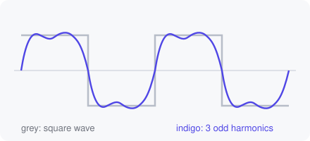

## From command line to controls

This script is meant to be run as `python main.py --wave square --grid`. The
demonstrator reads its `argparse` definitions and turns each option into a
control: a slider for `--freq`, a dropdown for `--wave`, a switch for
`--grid`. Changing one rebuilds `sys.argv` and re-runs the script, exactly as
if you had typed the new command. [Run it](demo:run).

| Option | Type | Control |
|---|---|---|
| `--freq` | `float` | slider |
| `--points` | `int` | slider |
| `--wave` | `choices=[...]` | dropdown |
| `--grid` | `store_true` | switch |
| `--title` | `str` | text box |

The options are defined in [`make_parser()`](demo:code=main.py:15-27).

## Fourier series

The square, sawtooth and triangle waves are built from a few sine terms. A
square wave of angular frequency $\omega$ is

$$
\operatorname{sq}(t) = \frac{4}{\pi} \sum_{k\ \text{odd}} \frac{\sin(k\omega t)}{k},
$$



which is what [`waveform()`](demo:code=main.py:30-42) computes:

```python
for k in range(1, harmonics + 1):
    if kind == "square" and k % 2:
        y += 4 / (np.pi * k) * np.sin(k * phase)
```

With only a few terms you can see the Gibbs ripples near the jumps:
[a rough square wave](demo:preset=rough_square), or
[switch to a triangle](demo:set?wave=triangle&harmonics=5), whose terms fall
off as $1/k^2$ and converge much faster.
