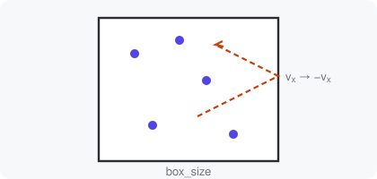

## Settings in a dataclass

Larger scripts often keep their settings together:

```python
@dataclass
class GasConfig:
    n_particles: int = 120
    temperature: float = 1.0
    integrator: Literal["euler", "verlet"] = "verlet"
```

The demonstrator turns each field with a default into a control. The type
hints pick the control: `int` and `float` become sliders, `bool` a switch, and
`Literal[...]` a dropdown. The keyword arguments of
[`main()`](demo:code=main.py:48-57) are added too. Their help text comes from
the docstring. [Run it](demo:run).

## The physics

Each particle moves in a straight line until it meets a wall, where the
velocity component normal to the wall reverses:



With gravity $g$ the velocity-Verlet update for one step $\Delta t$ is

$$
\mathbf{x}_{n+1} = \mathbf{x}_n + \mathbf{v}_n \Delta t - \tfrac12 g\,\hat{\mathbf{y}}\,\Delta t^2,
\qquad
\mathbf{v}_{n+1} = \mathbf{v}_n - g\,\hat{\mathbf{y}}\,\Delta t ,
$$

which is exact for constant acceleration, so the mean energy shown on the
plot stays put. See [`step()`](demo:code=main.py:30-45), then try
[the Euler integrator with gravity](demo:set?integrator=euler&gravity=3) and
watch the energy drift.

## Everything restarts

| Setting | Read | Change |
|---|---|---|
| dataclass fields | when `GasConfig()` is created in `main()` | restart |
| `main()` arguments | when `main()` is called | restart |

Because the configuration object is created inside `main()`, every value is
fixed once the animation starts, so each change re-runs the script. Try
[gas under gravity](demo:preset=falling_gas) or
[a crowded box](demo:preset=crowded).
