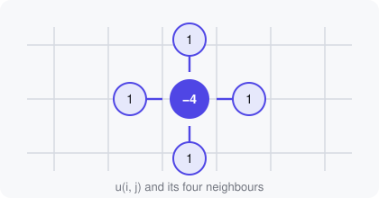

## The heat equation

Temperature $u(x, y, t)$ on a thin plate spreads out according to

$$
\frac{\partial u}{\partial t} = \alpha \left( \frac{\partial^2 u}{\partial x^2} + \frac{\partial^2 u}{\partial y^2} \right),
$$

where $\alpha$ is the diffusivity. A few spots, read from
`data/sources.csv`, are held at fixed temperatures: two hot, two cold.
[Start the simulation](demo:run) and watch the plate settle towards a steady
state.

## Discretising it

On a square grid with spacing $h$ and time step $\Delta t$, the Laplacian
becomes a *five-point stencil*:



```python
def laplacian(u):
    p = np.pad(u, 1, mode="edge")      # insulated edges
    return p[:-2, 1:-1] + p[2:, 1:-1] + p[1:-1, :-2] + p[1:-1, 2:] - 4 * u
```

The update itself is one line of [`HeatPlate.step()`](demo:code=heatsim/solver.py:19-23).
In grid units the scheme is only stable while $\alpha\,\Delta t / h^2 < \tfrac14$,
which is why the slider is labelled *stable below 0.25*:
[try 0.24](demo:set?DIFFUSIVITY=0.24), then
[cross the limit](demo:set?DIFFUSIVITY=0.3) and watch the checkerboard
instability grow.

## Live and restart parameters

| Parameter | Used | Change applies |
|---|---|---|
| `DIFFUSIVITY` | every frame, in `update()` | instantly |
| `STEPS_PER_FRAME` | every frame | instantly |
| `GRID` | to build the plate | after a restart |
| `SEED`, `NOISE` | to build the starting field | after a restart |

The [fine-grid preset](demo:preset=fine_grid) changes `GRID`, so the script
restarts with a new $128 \times 128$ plate. The grid size is read when the
plate is built in [`make_grid()`](demo:code=heatsim/grid.py:7-12), which lives
in a sub-module imported with a relative import.
