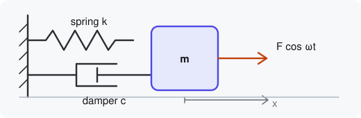

# A mass on a spring

A block of mass $m$ hangs on a spring of stiffness $k$, a damper resists its
motion, and an optional periodic force pushes it. The simulation on this page
integrates the motion live: [watch it run](demo:run), or
[pause it](demo:pause) to read along.



## Equation of motion

Dividing Newton's second law by the mass gives the classic form

$$
\ddot{x} + 2\zeta\omega_0\,\dot{x} + \omega_0^2\,x = F\,\omega_0^2 \cos(\omega_d t),
$$

where $\omega_0 = 2\pi f_0$ is the natural angular frequency and $\zeta$ is
the **damping ratio**.[^ratio] The script reads both values every frame, so the
sliders for [the frequency](demo:param=FREQ) and
[the damping](demo:param=DAMPING) change the motion immediately.

## Damping regimes
<!-- step: preset=critical code=main.py:20-21 -->

How quickly the motion dies away depends only on $\zeta$:

| Damping ratio | Behaviour | Try it |
|---|---|---|
| $\zeta = 0$ | oscillates forever | [undamped](demo:preset=undamped) |
| $0 < \zeta < 1$ | decaying oscillation | [light damping](demo:set?DAMPING=0.1&DRIVE=0) |
| $\zeta = 1$ | fastest return, no overshoot | [critical](demo:preset=critical) |
| $\zeta > 1$ | slow creep back | [heavy damping](demo:set?DAMPING=1.8&DRIVE=0) |

> [!TIP]
> The right-hand plot is the *phase portrait*: velocity against position.
> Undamped motion traces a circle; damping turns it into an inward spiral.

## Resonance
<!-- step: preset=resonance code=physics.py:7-12 -->

Drive the mass near its natural frequency and the response grows large,
limited only by damping. Try [the resonance preset](demo:preset=resonance),
then nudge the [driving frequency](demo:param=DRIVE_FREQ) away from 1 Hz. The
driving term lives in [`acceleration()`](demo:code=physics.py:7-12).

## The integrator

Each frame advances the state $(x, \dot x)$ with several small fourth-order
Runge–Kutta steps — [see `rk4_step()`](demo:code=physics.py:20-26):

```python
k1 = derivatives(state, t, *args)
k2 = derivatives(state + 0.5 * dt * k1, t + 0.5 * dt, *args)
k3 = derivatives(state + 0.5 * dt * k2, t + 0.5 * dt, *args)
k4 = derivatives(state + dt * k3, t + dt, *args)
state = state + dt / 6 * (k1 + 2 * k2 + 2 * k3 + k4)
```

The number of steps per frame follows `SPEED`, which is also live:
[double the speed](demo:set?SPEED=2) or [slow it down](demo:set?SPEED=0.5).
Changing `TRAIL` re-runs the script, because it sizes the history buffers when
the script starts ([see line 27](demo:code=main.py:27)). If things get messy,
[restart the simulation](demo:restart).

[^ratio]: $\zeta = c / (2\sqrt{km})$ for a damper with coefficient $c$.
