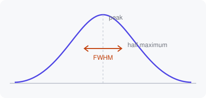

## A static figure

Not every demo is an animation. This script draws one figure and calls
`plt.show()`; the demonstrator renders it once. The only parameter is
`SHAPE`. The demonstrator offers it as a dropdown because the script looks it
up in a dictionary of shapes ([line 19](demo:code=main.py:19)). Changing it
re-runs the script, which takes a moment rather than a frame.
[Draw it](demo:run).

## The shapes

All four are normalised to a peak height of 1 at $x = 0$:

| Shape | Formula | Tails |
|---|---|---|
| Gaussian | $e^{-x^2/2}$ | very fast |
| Lorentzian | $\dfrac{1}{1 + x^2}$ | slow, $\propto x^{-2}$ |
| $\operatorname{sech}^2$ | $\operatorname{sech}^2 x$ | exponential |
| sinc | $\dfrac{\sin \pi x}{\pi x}$ | oscillating |



Compare [the Gaussian](demo:set?SHAPE=gaussian) with
[the Lorentzian](demo:preset=spectroscopy): at the same height the
Lorentzian keeps much more area in its tails. The shapes are plain lambdas:

```python
SHAPES = {
    "gaussian": lambda x: np.exp(-0.5 * x**2),
    "lorentzian": lambda x: 1 / (1 + x**2),
}
```
