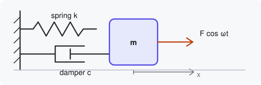

## Hints in comments
<!-- step: code=main.py:16-24 -->

This is the [oscillator demo](/examples/oscillator/) with one difference: its
constants carry `# demo:` comments. They have no effect when you run the file
with Python, but here they set the slider ranges, labels and units:

```python
FREQ = 1.0      # demo: range=0.2..4 step=0.05 label="Natural frequency" unit=Hz mode=live
WINDOW = 8.0    # demo: hide
DT = 1 / 240    # demo: ignore
```

[Run it](demo:run), then compare the controls with the plain oscillator: the
frequency now goes from 0.2 to 4 Hz in steps of 0.05, and `DT` and
`INTERVAL_MS` are gone.

## Overrides in demo.json
<!-- step: preset=resonance param=DRIVE_FREQ -->

`demo.json` has the last word. It:

| Override | Effect |
|---|---|
| `"DRIVE_FREQ": {"mode": "restart"}` | forces a re-run although the value is read live |
| `"WINDOW": {"hide": false, ...}` | brings back a control the hint hid |
| `"physics.py:NONLINEARITY": {...}` | relabels and re-ranges a value in another file |
| `"buttons": [...]` | adds **Kick the mass**, which calls `kick()` |

The [resonance preset](demo:preset=resonance) drives the mass at
$\omega_d = \omega_0$, where the steady amplitude is
$A = F / (2\zeta)$. [Set a light damping](demo:set?DAMPING=0.02) and the
response grows large; press **Kick the mass** to disturb it. The button
runs [`kick()`](demo:code=main.py:55-58).


